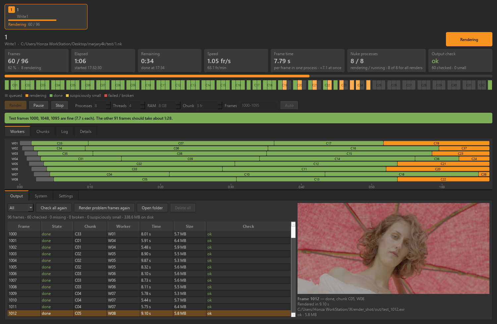

# JKrender



Fast local rendering for Nuke. JKrender splits a render into chunks and renders them in several
Nuke processes at once, each of which opens the script only once. Every finished frame is checked
on disk.

**Version 0.14 alpha.** It works in tests; expect rough edges.

## What it does

- **Chunks across processes.** By default the work is spread over 8 Nuke processes with 4 threads each.
  Chunks go to whichever process is free and shrink towards the end, so none sits idle.
- **Several renders in one window.** Each Write is a card at the top. They share one budget of
  Nuke processes, and up to 3 run side by side.
- **Output check.**
  - Image sequences: missing, empty or cut-off files (EXR, PNG, JPEG, DPX), and suspiciously small frames.
  - Movies (MOV / MP4 / MXF): codec, profile, fps, resolution, timecode and frame count against the Write's settings.
    The movie has a looping player with zoom.
- **Pause** freezes every Nuke mid-frame. **Stop** cleans up half-written frames and Nuke's temp files.
- **Workers**: a timeline of every process. **System**: CPU, RAM, disk, network, GPU, and each process.
- **Slate frame**: optional, for projects that start at 1001 with the slate on 1000.
- **Auto-tune processes** (on by default; off starts exactly the processes set):
  - finds the faster split of the PC per script (e.g. 8 × 4 or 4 × 8 threads) and remembers it;
  - remembers how much RAM one process of each script takes and starts only as many as fit.
- **RAM limit** (on by default, 90 %): over the limit fewer Nuke processes run, the one started last closing first,
  so Windows never swaps. The RAM setting per process is Nuke's cache limit (`-c`); a heavy script takes more than that.
- **Test frames first**: renders the first, middle and last frame before the rest, with an estimate.

## Files

| File | Runs in | Role |
|---|---|---|
| `JKrender.py` | Nuke's own Python (PySide6 and psutil) | the window and the scheduler |
| `jkrender_worker.py` | each Nuke process (`nuke -t`) | opens the script once and renders the chunks it is sent |
| `JKrender_NukeIntegration.py` | Nuke GUI | the **JKrender** menu (Ctrl+Alt+R) |
| `menu.py` | Nuke GUI | adds the menu when this folder is on Nuke's plugin path |
| `jkrender_deps.py` | Nuke GUI and the window | fetches numpy and OpenEXR for the EXR preview, and finds them |
| `INSTALL.txt` | | the install steps in short |
| `lib/<platform>-cp<version>/` | the window | numpy and OpenEXR, fetched on the first Nuke start (not in git) |
| `log/` | | one folder per render: script snapshot, job file and the log of every Nuke process (not in git) |

## Setup

1. Copy the whole `JKrender` folder into `~/.nuke/` (Windows: `%USERPROFILE%\.nuke\`).
2. Add one line to `~/.nuke/init.py`, creating the file if it is not there:

   ```python
   nuke.pluginAddPath("./JKrender")
   ```

3. Restart Nuke.
   - On the first start, JKrender asks to download numpy and OpenEXR for the EXR preview (about 15 MB).
   - They download in the background, with Nuke's own python, into `lib/win_amd64-cp311` (for Nuke 16).
   - If you say no, rendering still works and you are not asked again.
   - Delete `lib/DECLINED` to be asked again on the next start.

In Nuke, select Writes (or Groups that contain Writes) and choose **JKrender → Render Selected Write(s)**.

The window runs in Nuke's own Python, which already has PySide6 and psutil, so nothing else needs installing.

- **Behind a firewall:** set `JKRENDER_NO_FETCH=1` and fill the folder by hand:

  ```
  "C:\Program Files\Nuke16.0v9\python.exe" -m pip install --only-binary=:all: --target lib\win_amd64-cp311 numpy OpenEXR
  ```

- **Another Python:** set `JKRENDER_PYTHON`. That Python needs `python -m pip install PySide6 psutil numpy OpenEXR`.

Optional: for movie details and the movie player, put `ffprobe` / `ffmpeg` on PATH (`winget install ffmpeg`).

Renders and logs go to `log/` next to `JKrender.py`. If that folder is read-only, they go to `~/.jkrender/renders/`.
Settings are per user, in `~/.jkrender/settings.json`.
