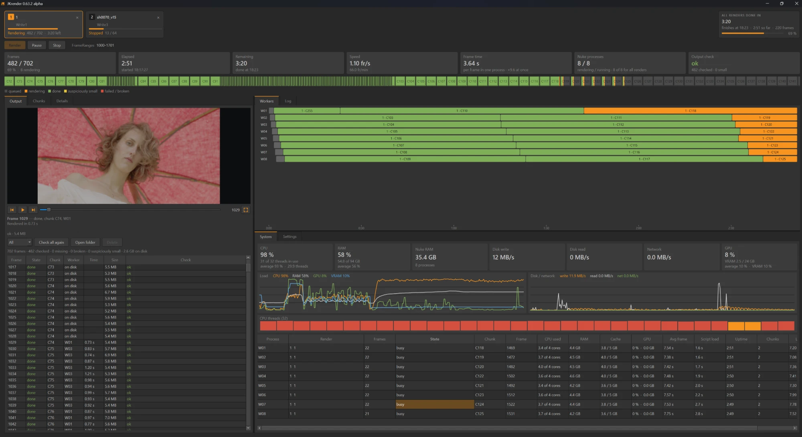

# JKrender

**Fast local rendering for Nuke.** JKrender splits a render into chunks and renders them in several Nuke processes at once,
on one PC, checks every frame it writes, and keeps the PC from running out of memory.



**Version 0.99.32** · Nuke 16 · Windows · free

📘 Manual, 19 pages: [English](docs/JKrender_manual_en.pdf) · [Čeština](docs/JKrender_navod.pdf) · [Deutsch](docs/JKrender_manual_de.pdf) · [Español](docs/JKrender_manual_es.pdf) · [Polski](docs/JKrender_manual_pl.pdf) · [Русский](docs/JKrender_manual_ru.pdf)

## Why

- ⚡ **Faster than one Nuke.** Several Nuke processes render side by side, each opening the script only once. A heavy 4K comp rendered **1.9–2.6× faster** than one Nuke with all the threads, on the same PC.
- 🧪 **Finds the best setup for your script.** *Test this script* tries processes × threads × cache on frames from the whole shot and tells you the fastest, and how much time each setup would cost on the whole shot.
- ✅ **Every frame checked.** Missing, empty or cut-off files, black or one-colour frames, NaN and inf, duplicated frames, a wrong size or bit depth. A red or green card tells you at a glance.
- 🛡️ **Never runs the PC out of memory.** Over 95 % RAM or VRAM the biggest process reloads Nuke after its chunk and starts again once it fits; nearly full, one closes at once.

## What it does

**Rendering**
- One Write (or a Group with Writes) per card; up to 3 renders side by side, sharing one budget of processes
- Chunks go to whichever process is free and get smaller towards the end, so all processes finish together
- Image sequences (EXR, PNG, JPEG, TIFF, DPX) and movies (MOV, MP4, MXF)
- Slate frame, your own frame range, Render again (only the missing frames or all of them)
- Use GPU: GPU nodes such as Kronos render on the graphics card
- Start the next render by itself when one ends

**Control while it renders**
- Pause freezes every Nuke mid-frame; Stop cleans up half-written frames and Nuke's temp files
- Add or remove processes on the fly, or move a process to another render
- Reload Nuke: a process can reopen the script after its chunk to give back the memory Nuke holds on to
- When will everything be done: a clock for all renders together

**Checking the output**
- Frame check when a render ends, pixel check in the background
- Movie check: codec, profile, fps, resolution, timecode and frame count against the Write
- Preview with zoom, a frame player, a looping movie player
- A red card on any error, a sound when a render finishes or fails

**Seeing what happens**
- Workers: a timeline of every Nuke process and its chunks
- System: CPU, RAM, disk, network, GPU and VRAM, for the PC and for each process
- A log per process, and a report of every render (speed, memory, settings)

**Safe when things go wrong**
- A Nuke that crashes: its chunk renders again, and the render ends whole
- JKrender itself going down: the renders come back the next time it opens
- A full graphics card or RAM: processes close one by one and come back when there is room

## Install

1. Copy the `JKrender` folder into `~/.nuke/` (Windows: `%USERPROFILE%\.nuke\`). A zip from GitHub gives `JKrender-main`: rename it to `JKrender`.
2. Add one line to `~/.nuke/init.py` (create the file if it is not there):

   ```python
   nuke.pluginAddPath("./JKrender")
   ```

3. Restart Nuke. On the first start JKrender offers to download numpy and OpenEXR (about 15 MB) for the EXR preview and, if the PC has no ffmpeg, ffmpeg (about 77 MB) for checking and playing movies. It renders without them too.

Then select Writes in Nuke and choose **JKrender → Render Selected Write(s)** (**Ctrl+Alt+R**).

<details>
<summary>More about installing</summary>

- The window runs in Nuke's own Python, which already has PySide6 and psutil: nothing else needs installing.
- **Behind a firewall:** set `JKRENDER_NO_FETCH=1` and fill the folder by hand:
  `"C:\Program Files\Nuke16.0v9\python.exe" -m pip install --only-binary=:all: --target lib\win_amd64-cp311 numpy OpenEXR`
- Said no to the download? Delete `lib/DECLINED` (numpy, OpenEXR) or `lib/DECLINED_FFMPEG` to be asked again.
- **Another Python:** set `JKRENDER_PYTHON`; it needs `pip install PySide6 psutil numpy OpenEXR`.
- ffmpeg: an ffmpeg on PATH or from `winget install ffmpeg` is used first; otherwise the LGPL build from [BtbN/FFmpeg-Builds](https://github.com/BtbN/FFmpeg-Builds), checked against its SHA-256, goes into `lib/ffmpeg` and travels with the JKrender folder.
- Render logs go to `log/` next to `JKrender.py` (deleted after 15 days); settings are per user in `~/.nuke/JKrender/settings`.

</details>

## For developers

`JKrender.py` is the window and the scheduler, `jkrender_worker.py` runs inside each Nuke process, `JKrender_NukeIntegration.py` and `menu.py` add the menu.
The tests run JKrender offscreen with a stand-in Nuke, no licence needed: `python tests/run_tests.py` (about 2 minutes), see [tests/README.md](tests/README.md).
What changed in each version: [CHANGELOG.md](CHANGELOG.md).
