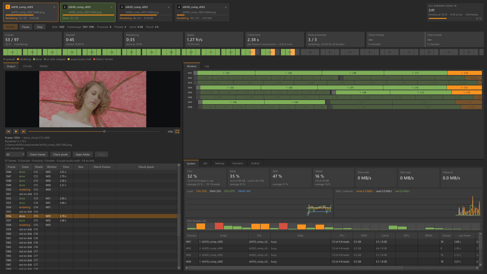

# JKrender

**Fast local rendering for Nuke.** JKrender splits a render into chunks and renders them in several Nuke processes at once,
on one PC, checks every frame it writes, and keeps the PC from running out of memory.



**Version 1.0.32** · Nuke 13+ · Windows · macOS · Linux

📘 Manual: [English](docs/JKrender_manual_en.pdf) · [Čeština](docs/JKrender_manual_cz.pdf) · [Deutsch](docs/JKrender_manual_de.pdf) · [Español](docs/JKrender_manual_es.pdf) · [Polski](docs/JKrender_manual_pl.pdf) · [Русский](docs/JKrender_manual_ru.pdf)

🎬 Video: [JKrender – Nuke render manager](https://www.youtube.com/watch?v=06y6xGNPQ1A&t=55s) on YouTube

## Why

- ⚡ **Faster than one Nuke.** Several Nuke processes render side by side, each opening the script only once. About **1.3–5× faster** than a single Nuke: light comps about 1–1.3×, heavy comps about 2–5×. How much depends on the script and on the computer: these come from the author's own tests, and on other workstations the numbers will differ. *Test this script* measures it on yours.
- 🧪 **Finds the best setup for your script.** *Test this script* tries processes × threads × cache on frames from the whole shot and tells you the fastest, and how much time each setup would cost on the whole shot. It takes a few minutes and is mainly for learning: you still set the Job settings by hand, but you see how your workstation's performance responds to different setups with this particular script.
- ✅ **Every frame checked.** Missing, empty or cut-off files; in the RGB, black or one-colour frames, NaN and inf, duplicated frames; a wrong size or bit depth. The other layers of a multi-layer EXR (AOVs, utility passes) are left to you. A red or green card tells you at a glance.
- 🛡️ **Never runs the PC out of memory.** When RAM or VRAM stays too full for a while, the process holding the most reloads Nuke after its frame and starts again once it fits; nearly full, one closes at once. Every threshold and time is in Settings.

## What it does

**Rendering**
- One Write (or a Group with Writes) per card; up to 3 renders side by side, sharing one budget of processes
- Chunks go to whichever process is free and get smaller towards the end, so all processes finish together
- Image sequences (EXR, PNG, JPEG, TIFF, DPX) and movies (MOV, MP4, MXF)
- Slate frame, your own frame range, Render again (only the missing frames or all of them)
- Use GPU: GPU nodes such as Kronos render on the graphics card
- Any pipeline's render hooks work as in one Nuke: afterRender (the Write's knob and `nuke.addAfterRender`) runs once, when every frame is on disk; beforeRender once in each process; the frame hooks on every frame. Workers and the Log show when they ran and how long they took. A hook that gathers something frame by frame sees only its own process's frames
- Every render starts with the NUKE_PATH, PYTHONPATH and OCIO of the Nuke that sent it; a pipeline's own variables (project, shot, task) too once their name prefix is in `settings.json`: `"pass_env": ["STUDIO_"]`. Names with KEY, TOKEN, SECRET or PASSWORD never go into a job
- Scripts of Nuke Non-commercial and Indie (`.nknc`, `.nkind`)
- Start the next render by itself when one ends

**Control while it renders**
- Pause freezes every Nuke mid-frame; Stop cleans up half-written frames and Nuke's temp files
- Add or remove processes on the fly, or move a process to another render
- Reload Nuke: a process reopens the script after a frame or a chunk to give back the memory Nuke holds on to
- When will everything be done: a clock for all renders together
- A new version: at start the window says so, with What's new, Update (download and install on a click) and Later; Settings › Check for updates asks at any time

**Checking the output**
- Frame check when a render ends, pixel check in the background, a slate with nothing on it found too
- Movie check: codec, profile, fps, resolution, timecode and frame count against the Write
- Preview with zoom, a frame player, a looping movie player; an EXR on its format, or its bbox alone
- A red card on any error, a sound when a render finishes or fails

**Seeing what happens**
- Workers: a timeline of every Nuke process, its chunks and the render hooks; empty time between renders is cut out
- System: CPU, RAM, disk, network, GPU and VRAM, for the PC and for each process
- A log per process, and a report of every render (speed, memory, settings); the Log says when the disk holds the render up

**Safe when things go wrong**
- A frame that fails is tried again in a fresh Nuke, up to three times; only a frame that keeps failing is given up, the rest of its chunk renders
- A Nuke that crashes: its half-written frame is deleted, its chunk renders again, and the render ends whole
- JKrender itself going down: the renders come back the next time it opens
- A full graphics card or RAM: processes close one by one and come back when there is room. The card may be NVIDIA, AMD or Intel Arc: on Windows its load and memory come from Windows itself, on Linux an AMD card's from the amdgpu driver

## Install

1. Copy the `JKrender` folder into `~/.nuke/` (Windows: `%USERPROFILE%\.nuke\`). The folder may come with another name (a zip from GitHub gives `JKrender-main`): always rename it to `JKrender`.
2. Add one line to `~/.nuke/init.py` (create the file if it is not there):

   ```python
   nuke.pluginAddPath("./JKrender")
   ```

3. Restart Nuke. On the first start JKrender offers to download numpy and OpenEXR (about 15 MB) for the EXR preview and, if the PC has no ffmpeg, ffmpeg (about 77 MB) for checking and playing movies. It renders without them too.

Then select Writes in Nuke and choose **JKrender → Render Selected Write(s)** (**Ctrl+Alt+R**).

<details>
<summary>More about installing</summary>

- **Nuke 16 and later:** the window runs in Nuke's own Python, which already has PySide6 and psutil: nothing else needs installing.
- **Nuke 13–15** ship PySide2, so the window runs in a Python of your own: install Python 3.10 or later and `python -m pip install PySide6 psutil`. JKrender finds it (or set `JKRENDER_PYTHON` to its python executable); numpy and OpenEXR for it are offered at the next Nuke start after the first render.
- **Behind a firewall:** set `JKRENDER_NO_FETCH=1` and fill the folder by hand:
  `"C:\Program Files\Nuke16.0v9\python.exe" -m pip install --only-binary=:all: --target lib\win_amd64-cp311 numpy OpenEXR`
- Said no to the download? Delete `lib/DECLINED` (numpy, OpenEXR) or `lib/DECLINED_FFMPEG` to be asked again.
- ffmpeg: an ffmpeg on PATH or from `winget install ffmpeg` is used first; otherwise the LGPL build from [BtbN/FFmpeg-Builds](https://github.com/BtbN/FFmpeg-Builds), checked against its SHA-256, goes into `lib/ffmpeg` and travels with the JKrender folder.
- **macOS:** clone or unpack into `~/.nuke/JKrender` (hidden in Finder: Cmd+Shift+G, `~/.nuke`) and add the same line to `~/.nuke/init.py`. The window runs in Nuke's own Python from `Nuke*.app/Contents`; the first start offers ffmpeg when the Mac has none (Homebrew's is used first). On Apple silicon the GPU and VRAM tiles show the GPU and its share of the unified memory; the RAM rules work as on Windows.
- **Linux:** clone into `~/.nuke/JKrender` and add the same line to `~/.nuke/init.py`; the first start offers ffmpeg (or `sudo apt install ffmpeg`). GPU and VRAM per process come from `nvidia-smi`, with an AMD card from the amdgpu driver; under WSL the driver lists no processes, so those columns stay empty. The test suite runs on Ubuntu 24.04 (WSL) with Nuke 17.1 Non-commercial.
- **Nuke Non-commercial and Indie:** scripts saved as `.nknc` / `.nkind` render too; every Nuke process starts in the same mode (`--nc` / `--indie`). Nuke's own limits apply (Non-commercial: output up to HD, 1920 x 1080).
- Render logs go to `log/` next to `JKrender.py` (deleted after 15 days); settings are per user in `~/.nuke/JKrender/settings`.

</details>

## For developers

`JKrender.py` is the window and the scheduler, `jkrender_worker.py` runs inside each Nuke process, `JKrender_NukeIntegration.py` and `menu.py` add the menu, `jkrender_deps.py` fetches numpy, OpenEXR and ffmpeg.
The tests run JKrender offscreen with a stand-in Nuke, no licence needed: `python tests/run_tests.py` (about 8 minutes; `--real` also renders with the real Nuke), see [tests/README.md](tests/README.md).
How the code is laid out, what to keep and how to send a change: [CONTRIBUTING.md](CONTRIBUTING.md).
What changed in each version: [CHANGELOG.md](CHANGELOG.md).
